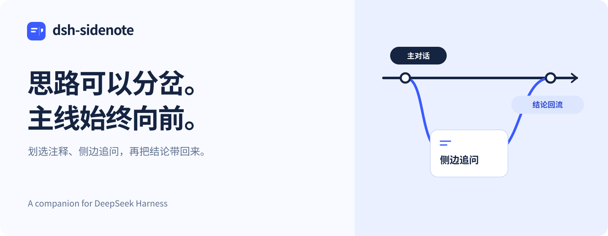

<p align="center">
  <picture>
    <source media="(max-width: 640px)" srcset="docs/assets/hero-compact.svg">
    
  </picture>
</p>

<p align="center">
  为 <b>DeepSeek Harness</b> 加上侧边聊天与划选注释。<br>
  读到一个疑问，就在旁边聊透；有了结论，再带回正在推进的任务。
</p>

<p align="center">
  <a href="#安装">安装</a> ·
  <a href="#看看它如何工作">功能演示</a> ·
  <a href="docs/usage.md">使用指南</a> ·
  <a href="README_EN.md">English</a>
</p>

<p align="center">
  <a href="https://www.npmjs.com/package/dsh-sidenote"></a>
  <a href="https://github.com/g-yixuan/dsh-sidenote/actions/workflows/ci.yml"></a>
  <a href="LICENSE"></a>
</p>


<p align="center"><sub>dsh-sidenote 0.7.2 · DSH 0.2.1-rc.2 · DeepSeek V4.1 Flash · 真实交互录制</sub></p>

## 安装

在已安装 DSH 的环境中执行：

```bash
dsh plugin --profile web add dsh-sidenote
```

打开 DSH Web，点击会话顶栏的 **「侧边」**，或划选一段回复开始。也可输入 `/side` 打开侧聊，用 `Alt+S` 切换主、侧输入焦点。

自 dsh-sidenote **0.8.0** 起，主线维护 DSH **0.2.1 系列（rc.2 起）**，允许同系列后续 RC 及正式版安装，无需 `dsh-better-sidebar`。已验证版本为 0.2.1-rc.2／rc.3／rc.4／rc.5；未来 RC 允许安装不等于已经验证，历史包声明不变。DSH 0.2.0-rc.2 固定 `dsh-sidenote@0.7.6`，更早宿主固定各自最后兼容包，详见[兼容政策](docs/compatibility.md)。

## 一个任务，容得下更多思路

### 有疑问，在旁边聊透

评审方案时想追问一个细节，读代码时想弄清一种实现，都可以从当前对话开一个侧聊。**完整历史随 fork 保留**，不用再交代一遍背景。

侧聊有独立的多轮对话、工具卡、模型和权限切换，也支持图片、`@` 引用以及面板内审批。主线和支线各自推进。

刷新或重启 DSH 后，侧聊自身的问答仍留在侧聊区，继承的主线上下文保持折叠分区。保存为正式会话保留这个分区；从保存的会话再次开侧聊时，才建立新的继承范围。来源尚未确认时可以阅读消息，确认后再使用回流。

### 有想法，直接落在原文上

划选主对话或侧聊中的一段回复，写下问题或修改意见。**原文和注释一起保留**，可累积多条，发送前预览、移除，正文草稿照常编辑。

读到「提示“未找到”，并给出放宽条件建议」，就选中这一句，追问「给一版可直接使用的空状态」。

### 有结论，带回正在做的事

点击侧聊回答操作栏右侧的「带回主对话」图标，**问题与回答成对带回**，出现在主输入框上方，随下一条消息送入主线。也可以整段回流，或将值得保留的侧聊保存为正式会话。

## 看看它如何工作

**划选一句 → 带着上下文追问 → 把结论带回主线。**


[观看清晰版 MP4](docs/assets/demo.mp4) · [查看静态截图](docs/assets/workflow.jpg)

<sub>2026-10-25 录制于 dsh-sidenote 0.7.2 / DSH 0.2.1-rc.2。以笔记搜索设计为例，真实调用官方 DeepSeek V4.1 Flash 生成回答；约 43 秒的录屏展示实际操作与完整回复过程。<a href="docs/assets/README.md">素材说明</a></sub>

## 用起来顺手的细节

| 你关心的事 | Sidenote 如何处理 |
|---|---|
| 之前聊过的内容 | 侧聊继承完整历史，默认折叠，按需展开。 |
| 一次有多处意见 | 多条注释可以一起发送，也能逐条预览和移除。 |
| 发不出去怎么办 | 发送失败保留注释与正文，便于重试。 |
| 刷新后继续 | 已保存的注释保留；侧栏未恢复时，可从 `/side` 重开原侧聊。 |
| 不想让支线堆满列表 | 侧聊默认不进入会话列表和搜索，保存为正式会话后才列出。 |
| 结论值得长期保留 | 保存为正式会话，后续继续讨论。 |

具体操作、恢复行为和划选范围见[使用指南](docs/usage.md)。

## 兼容与帮助

维护窗口按 **当前基础版本系列** 滚动，侧聊共用原生 Conversation。同系列 RC 持续覆盖；新系列完成验收并随插件发布后，再停止维护原系列。日常 PR 检查当前系列的最低版和最新已验证版，每日探测新增宿主、每周回归全部窗口内版本。窗口外保留最后兼容插件。详见[兼容与维护政策](docs/compatibility.md)；公开安装以对应 Release 为准。

遇到问题或有改进建议，欢迎[反馈](https://github.com/g-yixuan/dsh-sidenote/issues/new/choose)，附上 DSH 与插件版本、复现步骤或截图。

## 一起完善 Sidenote

欢迎补充使用反馈、复现问题、改进文档和提交代码，中文与 English 都可以。开发环境、命令和检查步骤见[贡献指南](CONTRIBUTING.md)。

[仓库维护](docs/maintaining.md) · [发布指南](docs/releasing.md) · [MIT License](LICENSE)
