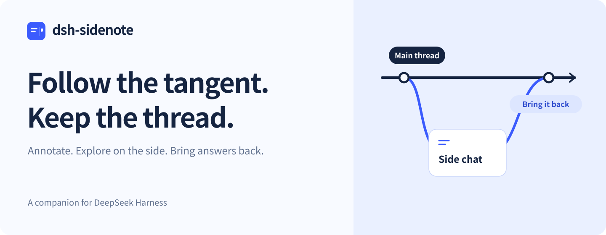
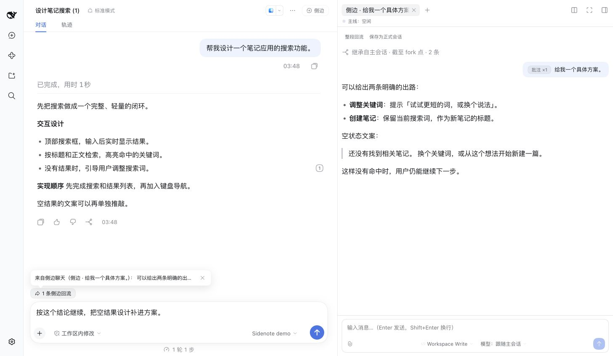
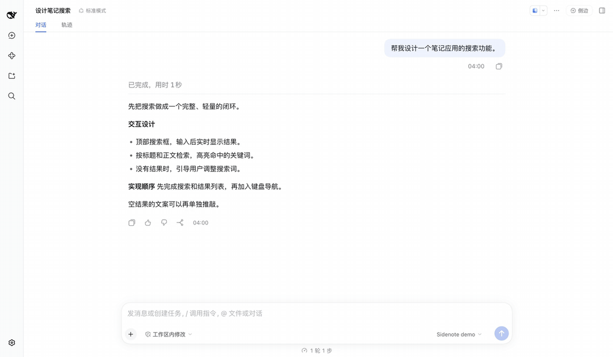

<p align="center">
  <picture>
    <source media="(max-width: 640px)" srcset="docs/assets/hero-en-compact.svg">
    
  </picture>
</p>

<p align="center">
  Side chats and selection annotations for <b>DeepSeek Harness</b>.<br>
  Explore a question beside your conversation. Bring the answer back to the task at hand.
</p>

<p align="center">
  <a href="#install">Install</a> ·
  <a href="#see-it-in-action">Demo</a> ·
  <a href="docs/usage_EN.md">User guide</a> ·
  <a href="README.md">中文</a>
</p>

<p align="center">
  <a href="https://www.npmjs.com/package/dsh-sidenote"></a>
  <a href="https://github.com/g-yixuan/dsh-sidenote/actions/workflows/ci.yml"></a>
  <a href="LICENSE"></a>
</p>



<p align="center"><sub>dsh-sidenote 0.6.0 · DSH 0.2.0-rc.2 · Native sidebar · Light theme</sub></p>

## Install

With DSH already installed, run:

```bash
dsh plugin --profile web add dsh-sidenote
```

Open DSH Web and click **Side** in the session header, or select a passage in a reply. You can also open a side chat with `/side` and switch focus between main and side inputs with `Alt+S`.

The current branch supports DSH 0.2.0-rc.2 / 0.2.1-rc.2 without dsh-better-sidebar. Older hosts pin the last compatible dsh-sidenote@0.6.5; see the [compatibility policy](docs/compatibility_EN.md).

## One task. Room to explore.

### Follow a question on the side

Clarify a detail during a design review or explore an implementation while reading code. Open a side chat from the current conversation. **The fork preserves the full history**, so you can pick up without explaining the context again.

Side chats support multiple turns, tool cards, model and permission switching, images, `@` references, and approvals inside the panel. Main and side conversations can move forward independently.

### Put your feedback on the passage

Select part of a reply in the main conversation or a side chat, then add a question or comment. **The original passage and your note stay together.** Collect several notes, preview or remove them before sending, and keep writing in the composer.

For example, select “When no results are found, help the user adjust their search” and ask how to keep that user from getting stuck.

### Bring useful answers back

Click **Send back to main session** below a side reply to bring back both **the question and its answer**. They appear above the main composer and travel with your next message. You can also send back the whole conversation or save a side chat as a regular session.

## See it in action

**Select a passage → explore it with context → bring the answer back.**



[Watch the full-resolution MP4](docs/assets/demo.mp4) · [View the still screenshot](docs/assets/workflow.jpg)

<sub>Newly recorded on dsh-sidenote 0.6.0 / DSH 0.2.0-rc.2. These Chinese-language screenshots and recording show real interface interactions in an isolated environment. Conversations and replies are synthetic examples supplied by a local demo model.</sub>

## Details that keep work moving

| What matters | How Sidenote handles it |
|---|---|
| Earlier context | Side chats inherit the full history, collapsed until you need it. |
| Several pieces of feedback | Send annotations together, or preview and remove them individually. |
| A failed send | Annotations and draft text stay available for retry. |
| Picking up after a reload | Saved annotations persist. If the sidebar is not restored, reopen the original side chat through `/side`. |
| Keeping the session list focused | Side chats stay out of the list and search until saved as regular sessions. |
| A conversation worth keeping | Save it as a regular session and continue later. |

See the [user guide](docs/usage_EN.md) for controls, recovery behavior, and selection boundaries.

## Compatibility and help

The current branch maintains two exact hosts: **DSH 0.2.0-rc.2 and 0.2.1-rc.2**, reusing native Conversation. Outside the window, users retain plugin 0.6.5; the current branch no longer backports features or runs those host checks. The exact versions in the [compatibility and maintenance policy](docs/compatibility_EN.md) define the supported scope; check the corresponding Release for published versions.

For troubleshooting, enable **Settings → General → dsh-sidenote diagnostic mode** to inspect and manually export the integration status. [Report a problem or suggest an improvement](https://github.com/g-yixuan/dsh-sidenote/issues/new/choose).

## Help shape Sidenote

Feedback, reproductions, documentation, and code contributions are welcome in English or Chinese. See the [contributing guide](CONTRIBUTING_EN.md) for the development setup, commands, and required checks.

[Repository maintenance](docs/maintaining_EN.md) · [Release guide](docs/releasing_EN.md) · [MIT License](LICENSE)
