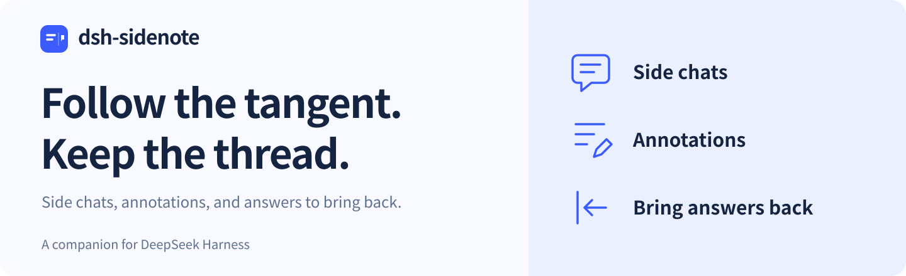
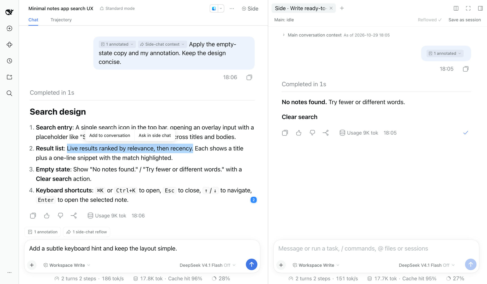
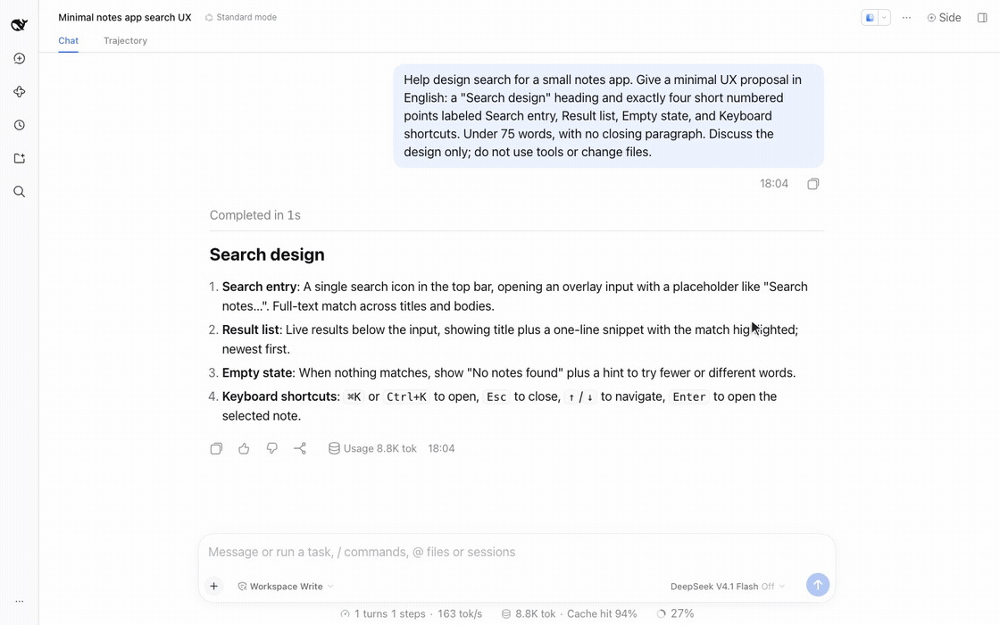

<p align="center">
  <picture>
    <source media="(max-width: 640px)" srcset="docs/assets/hero-en-compact.svg">
    
  </picture>
</p>

<p align="center">
  Side chats, selection annotations, and answer handback for <b>DeepSeek Harness</b>.<br>
  Explore ideas and give precise feedback with the native chat experience.
</p>

<p align="center">
  <a href="#use-what-you-need">Features</a> ·
  <a href="#the-familiar-chat-experience-on-the-side">Native experience</a> ·
  <a href="#install">Install</a> ·
  <a href="#see-it-in-action">Demo</a> ·
  <a href="docs/usage_EN.md">User guide</a> ·
  <a href="README.md">中文</a>
</p>

<p align="center">
  <a href="https://www.npmjs.com/package/dsh-sidenote"></a>
  <a href="https://github.com/g-yixuan/dsh-sidenote/actions/workflows/ci.yml"></a>
  <a href="LICENSE"></a>
</p>



<p align="center"><sub>dsh-sidenote 0.7.6 · DSH 0.2.1-rc.2 · DeepSeek V4.1 Flash · Recorded live</sub></p>

## Use what you need

### Side chats for a thought worth exploring

Check an implementation, clarify a detail, or follow a tangent. Click **Side** in the session header or enter **`/side`** and write your question. The side chat inherits the main conversation's effective context and supports multi-turn discussion and tools. Main and side conversations can move forward independently.

Keep several independent side-chat tabs open, reopen a closed chat through `/side`, or save a discussion as a regular session to continue later.

### Annotations for feedback on a passage

While reviewing a plan or reading an answer, select a passage, choose **Add to conversation**, and write your question or comment. The original text and your note stay together. Collect several annotations, preview and edit them, and send them with your next message.

Annotate in the main conversation or a side chat. To explore a passage from the main conversation further, choose **Ask in side chat** to carry the selection over.

### Bring useful answers back to the main task

When a side chat produces an answer you want to use, click **Bring back to main conversation** beside the reply. The question and answer appear together above the main composer. Preview and choose what to send with your next message so the main conversation can build on the finding.

Pick one answer or use **Reflow all** for the side chat's new, completed question–answer pairs. Your draft text and pending handbacks stay separate.

## Install

With DSH already installed, run the following command.

```bash
dsh plugin --profile web add dsh-sidenote
```

Open DSH Web and click **Side** or enter **`/side`** to start a side chat. To annotate, select text in a reply and choose **Add to conversation**.

The main branch maintains **DSH 0.2.2 (from rc.1)** using the native conversation interface. Version 0.2.2-rc.1 is verified, and later RCs and the unsuffixed release in that series may be installed, with verification recorded against exact versions. DSH 0.2.2 requires Node.js 24.9 or newer. This range applies from plugin 0.8.3. Version 0.8.2 supports the 0.2.1 series. DSH 0.2.1 users pin `dsh-sidenote@0.8.2`, 0.2.0-rc.2 pins `dsh-sidenote@0.7.6`, and earlier hosts retain their last compatible package. See the [compatibility policy](docs/compatibility_EN.md).

## The familiar chat experience, on the side

Side chats **use DSH's native composer, message flow, and tool cards**. Model and reasoning settings, permissions, images, `@` references, and commands work through the familiar controls. Respond to approvals and questions right inside the side panel.

Sidenote adds collapsible inherited context, annotation previews, and question–answer handback to that native interface, with care for everyday interactions.

| When you need to… | How Sidenote helps |
|---|---|
| Move between composers | `Alt+S` switches focus between the main composer and the current side chat. |
| Check a passage and your feedback | Hover to preview, click to keep the preview open, edit notes in place, and remove items individually. |
| Review context you already sent | Open the annotation and handback chips in the corresponding message. |
| Retry a failed send | Draft text, annotations, and pending handbacks stay available. |
| Continue after a reload or restart | Side-chat history and saved annotations persist. Reopen through `/side` if the sidebar is not restored. |
| Keep the session list focused | Side chats stay hidden until saved as regular sessions, when they appear in the list and search. |

See the [user guide](docs/usage_EN.md) for controls, recovery behavior, and selection boundaries.

## Context and model costs

A side chat uses the main conversation's effective context, fixes the included progress when you send its first message, and continues independently from there. Existing compaction summaries and the retained tail remain in effect. **Opening a side chat does not make a model request**. Inference starts when you send a question.

**Matching request prefixes may reuse the model provider's context cache and reduce input costs.** DeepSeek, for example, caches request prefixes automatically and bills cache-hit input at its cached rate. Actual hits depend on the model and provider, matching request prefixes, and whether the cache has been created and remains available. Further model calls follow your provider's billing rules. [DeepSeek caching guide](https://api-docs.deepseek.com/guides/kv_cache/) · [Input pricing](https://api-docs.deepseek.com/quick_start/pricing/)

## See it in action

This note-search design review shows how annotations, side chats, and handback can work together in one task.



[Watch the full-resolution MP4](docs/assets/demo-en.mp4) · [View the still screenshot](docs/assets/workflow-en.jpg)

<sub>Recorded on 2026-10-29 with dsh-sidenote 0.7.6 / DSH 0.2.1-rc.2. This English-language note-search design example uses real responses from the official DeepSeek V4.1 Flash API. The approximately 38-second recording shows the real interactions and complete model responses. <a href="docs/assets/README.md">About the media</a></sub>

## Compatibility and help

The rolling window covers **the current RC/release series, with one optional admitted alpha series**, sharing native Conversation. Full validation admits an alpha series while maintenance continues for the current RC series. PRs test each series' minimum and latest verified hosts. Daily discovery tracks latest / next / alpha and new in-window hosts, with weekly regression across all in-window versions. When the current series rolls forward, retired hosts retain their last compatible plugin. See the [compatibility and maintenance policy](docs/compatibility_EN.md); published installations follow their Release declarations.

[Report a problem or suggest an improvement](https://github.com/g-yixuan/dsh-sidenote/issues/new/choose), including your DSH and plugin versions, reproduction steps, or a screenshot.

## Help shape Sidenote

Feedback, reproductions, documentation, and code contributions are welcome in English or Chinese. See the [contributing guide](CONTRIBUTING_EN.md) for the development setup, commands, and required checks.

[Repository maintenance](docs/maintaining_EN.md) · [Release guide](docs/releasing_EN.md) · [MIT License](LICENSE)
