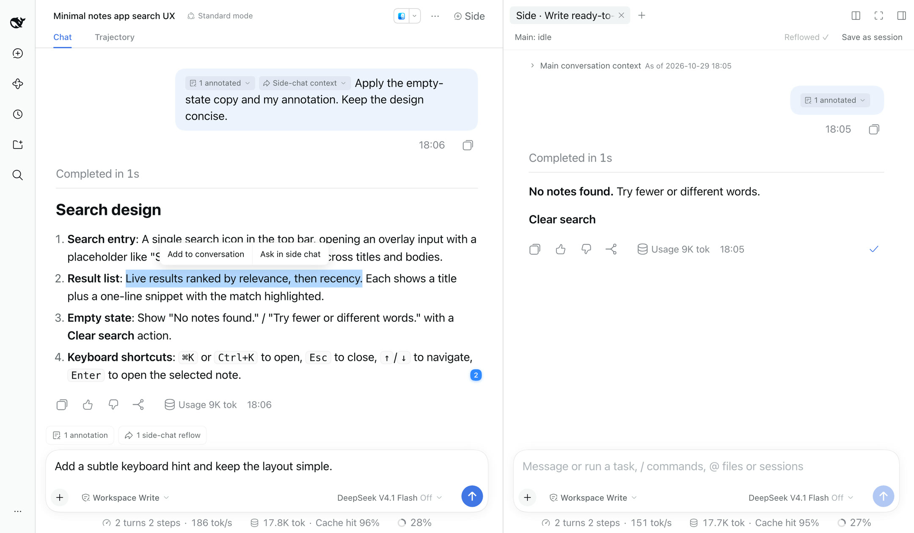
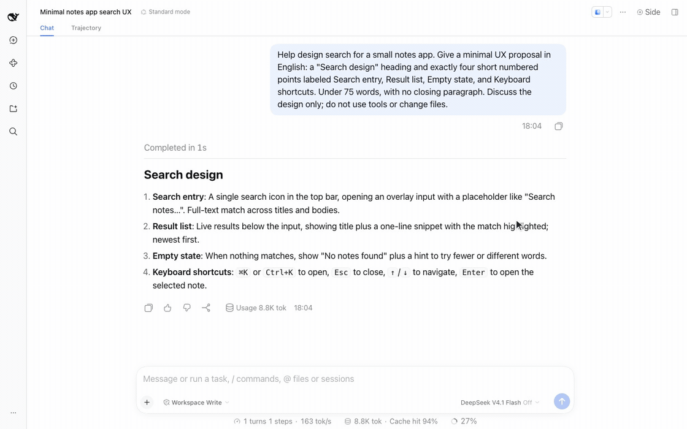

<p align="center">
  <picture>
    <source media="(max-width: 640px)" srcset="docs/assets/hero-en-compact.svg">
    
  </picture>
</p>

<p align="center">
  Side chats and selection annotations for <b>DeepSeek Harness</b>.<br>
  Explore a question beside your conversation. Bring the answer back to the task at hand.
</p>

<p align="center">
  <a href="#install">Install</a> ·
  <a href="#see-it-in-action">Demo</a> ·
  <a href="docs/usage_EN.md">User guide</a> ·
  <a href="README.md">中文</a>
</p>

<p align="center">
  <a href="https://www.npmjs.com/package/dsh-sidenote"></a>
  <a href="https://github.com/g-yixuan/dsh-sidenote/actions/workflows/ci.yml"></a>
  <a href="LICENSE"></a>
</p>



<p align="center"><sub>dsh-sidenote 0.7.6 · DSH 0.2.1-rc.2 · DeepSeek V4.1 Flash · Recorded live</sub></p>

## Install

With DSH already installed, run:

```bash
dsh plugin --profile web add dsh-sidenote
```

Open DSH Web and click **Side** in the session header, or select a passage in a reply. You can also open a side chat with `/side` and switch focus between main and side inputs with `Alt+S`.

The current branch maintains **DSH 0.2.1 (from rc.2) and 0.2.0 (from rc.2)**, allowing later RCs and the unsuffixed release within each series, without dsh-better-sidebar. Verified hosts are 0.2.0-rc.2 and 0.2.1-rc.2 / rc.3 / rc.4 / rc.5; future installable RCs are not automatically verified. The broader range ships in a subsequent plugin release; historical declarations remain unchanged. Older hosts pin dsh-sidenote@0.6.5. See the [compatibility policy](docs/compatibility_EN.md).

## One task. Room to explore.

### Follow a question on the side

Clarify a detail during a design review or explore an implementation while reading code. Open a side chat from the current conversation. **The fork preserves the full history**, so you can pick up without explaining the context again.

Side chats support multiple turns, tool cards, model and permission switching, images, `@` references, and approvals inside the panel. Main and side conversations can move forward independently.

### Put your feedback on the passage

Select part of a reply in the main conversation or a side chat, then add a question or comment. **The original passage and your note stay together.** Collect several notes, preview or remove them before sending, and keep writing in the composer.

For example, select the suggestion to show “No notes found” and ask for ready-to-use empty-state copy.

### Bring useful answers back

Click the **Bring back to main conversation** icon on the right of a side reply’s action row to bring back both **the question and its answer**. They appear above the main composer and travel with your next message. You can also send back the whole conversation or save a side chat as a regular session.

## See it in action

**Select a passage → explore it with context → bring the answer back.**



[Watch the full-resolution MP4](docs/assets/demo-en.mp4) · [View the still screenshot](docs/assets/workflow-en.jpg)

<sub>Recorded on 2026-10-29 with dsh-sidenote 0.7.6 / DSH 0.2.1-rc.2. This English-language note-search design example uses real responses from the official DeepSeek V4.1 Flash API. The approximately 38-second recording shows the real interactions and complete model responses. <a href="docs/assets/README.md">About the media</a></sub>

## Details that keep work moving

| What matters | How Sidenote handles it |
|---|---|
| Earlier context | Side chats inherit the full history, collapsed until you need it. |
| Several pieces of feedback | Send annotations together, or preview and remove them individually. |
| A failed send | Annotations and draft text stay available for retry. |
| Picking up after a reload | Saved annotations persist. If the sidebar is not restored, reopen the original side chat through `/side`. |
| Keeping the session list focused | Side chats stay out of the list and search until saved as regular sessions. |
| A conversation worth keeping | Save it as a regular session and continue later. |

See the [user guide](docs/usage_EN.md) for controls, recovery behavior, and selection boundaries.

## Compatibility and help

The rolling window maintains **the current series and the preceding series**, sharing native Conversation. RCs remain covered within each series; the oldest series retires only after a new series passes admission and ships in a plugin release. PRs test each series' minimum and latest verified hosts; daily discovery detects new hosts and weekly runs cover all in-window versions. Retired hosts retain their last compatible plugin. See the [compatibility and maintenance policy](docs/compatibility_EN.md); published installations follow their Release declarations.

For troubleshooting, enable **Settings → General → dsh-sidenote diagnostic mode** to inspect and manually export the integration status. [Report a problem or suggest an improvement](https://github.com/g-yixuan/dsh-sidenote/issues/new/choose).

## Help shape Sidenote

Feedback, reproductions, documentation, and code contributions are welcome in English or Chinese. See the [contributing guide](CONTRIBUTING_EN.md) for the development setup, commands, and required checks.

[Repository maintenance](docs/maintaining_EN.md) · [Release guide](docs/releasing_EN.md) · [MIT License](LICENSE)
