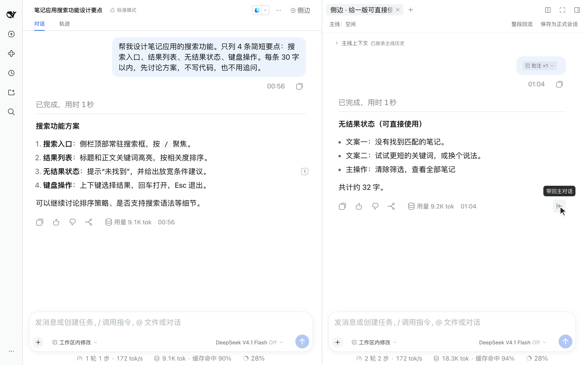
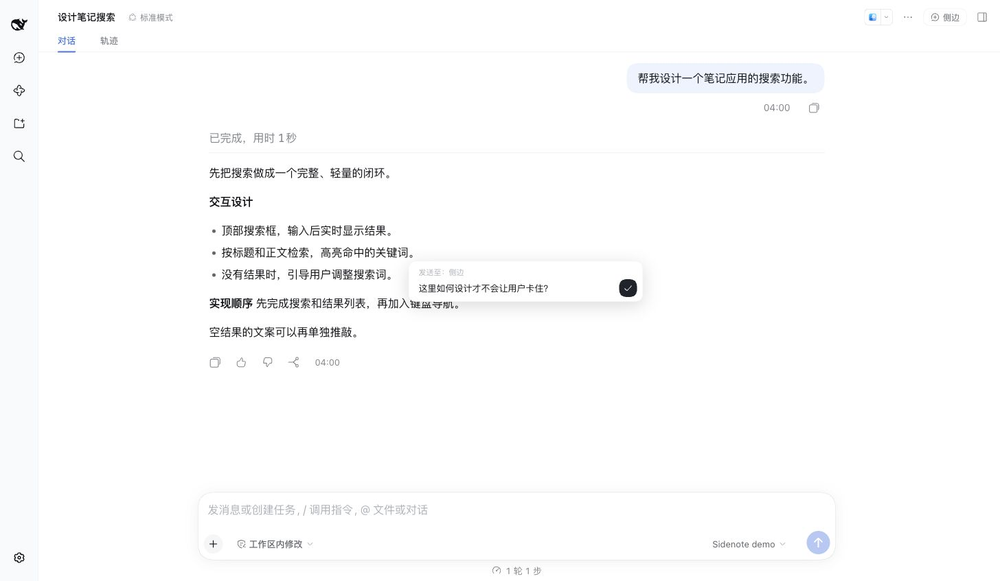
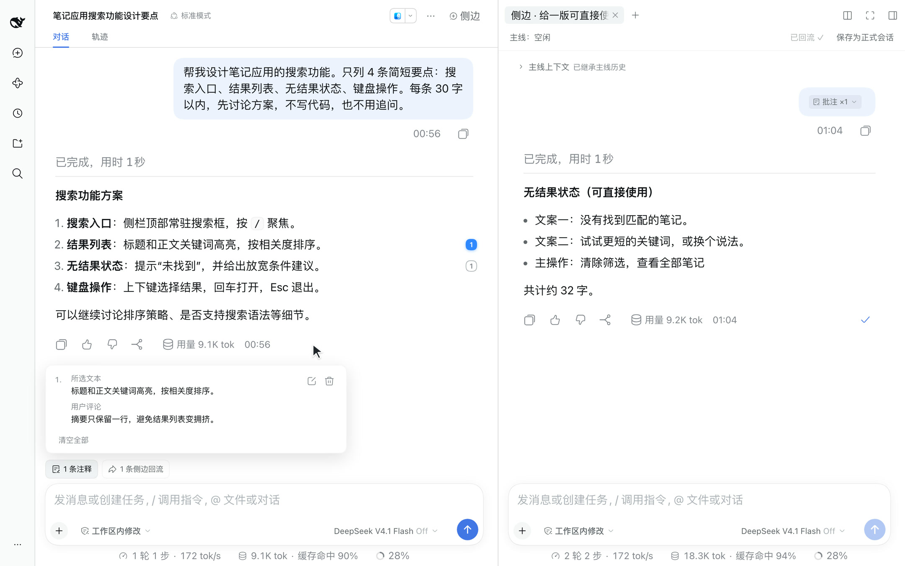

# Sidenote 使用指南

[English](usage_EN.md) · 中文 · [回到首页](../README.md)

## 开一个侧边聊天

侧聊从当前主会话 fork，保留完整历史快照，不压缩成摘要。它是真实、独立的 DSH 会话，可以继续多轮讨论。

三个入口：会话顶栏的「侧边」、右侧栏的入口，以及主输入框中的 `/side`。侧聊直接使用主聊同一套原生输入框、消息流、工具卡、模型与推理强度、权限、命令、文件引用和附件；审批与提问可在面板内直接答复。只有正常完成才发完成通知，停止或失败不算完成。

使用支持图片的模型时，可聚焦侧聊输入框，按 `⌘V` / `Ctrl+V` 粘贴剪贴板中的图片，也可点击附件按钮选择图片。图片会显示在输入框上方，发送前可以移除；可单独发送图片，也可与文字一起发送。

打开侧聊即可看到「主线上下文」，继承历史默认折叠，点击展开会先显示最近的继承消息，再向上翻阅更早的内容；若有运行中进展，则先显示进展快照的末尾；尚无进展内容时，仍显示最近的继承消息。展开后按「继承历史 → 后续进展 → 侧聊消息」排列。进展区保持紧凑，停留底部时随更新滚动；向上阅读会暂停跟随，点击「回到最新」可恢复。思考和工具调用默认收起，点击可看全文。侧聊回复完成不会把阅读位置拉回底部。主线运行中开启侧聊时，进展在首次发送前持续更新，发送后固定为该次实际携带的快照，并显示时间；图片与文字一起发送也保留同样的快照、时间和展开详情。输入框在空会话时也保持底部位置。折叠状态和原生草稿刷新后保留；`Alt+S` 在主、侧输入框之间切换焦点。

主线连续插话时，快照包含继承切点之后的完整进展；侧聊新发出的消息与回答始终留在继承历史之外。首次发送的待确认气泡会立即显示问题和附件，后台进展协议不会挤进气泡。

主线经过压缩后，「主线上下文」从最新已生效的压缩摘要开始，保留宿主未压缩的尾部和后续进展。多次压缩只采用最新摘要，失败或尚未提交的压缩不会隐藏原内容。未压缩的尾部可能产生在压缩事件之前，仍会完整保留。宿主裁剪过的工具输出使用裁剪后的有效结果，不重新带入旧全文，也不会遗漏保留部分。原会话的历史记录不被删除。主线排队中的任务仍留在主线，新侧聊不会执行这些队列副本。



关闭侧聊后，可在 `/side` 选项中重开最近关闭的原子会话。普通侧聊入口聚焦已有 tab；原生 page kind 每个 pane 一个，分栏可以容纳多个 pane。当前主线维护已准入的原生宿主，窗口外固定插件 0.6.5，见[兼容政策](compatibility.md)。

### 会话列表与找回侧聊

侧聊默认不进入左侧会话列表或搜索结果，创建时也不会先出现再消失。关闭或刷新不会把已登记的侧聊重新放回列表；保存为正式会话生成的副本才会列出。

当前支持的宿主保持隐藏侧聊可运行。若要找回较早的侧聊，可开启 **设置 → 通用设置 → 在会话列表中显示侧边聊天**；该选择仅保存在当前浏览器、当前 DSH 地址。旧版 0.6.5 的归档隐藏规则见对应历史 Release。此设置不会恢复已删除的会话或取消旧版已有的归档状态，详见[兼容政策](compatibility.md)。

## 划选与注释

1. 在 assistant 已完成的回复中划选一段文字。
2. 从浮层选择添加到主对话或在侧边聊天中提问，填写注解。
3. 点击编辑器外部或按 `Enter` 保存新注解；按 `Esc` 取消。
4. 输入框上方的注释与侧边回流标签横向排列。悬停即可查看完整原文、注解或回流问答，移入浮层可继续阅读；点击标签可固定打开，Esc 或点击外部关闭。浮层采用紧凑高度，长内容在内部滚动；悬停标签时右侧的 × 柔和显现，可一键清空对应的注释或回流，不影响另一类内容和正文。注解可直接编辑，失焦保存、Esc 取消，也可逐条移除或清空全部。





引用与注解全文保留，不写进正文草稿。可以只发引用，也可以和正文、图片附件及 `@` 引用一起发送。多次划选会累积多条注释，原文右侧的编号帮助定位来源。

**主对话中的划选**可以发往主对话或侧聊。发往侧聊时，先等待选定 tab 的真实子会话就绪；等待期间可按 `Esc` 取消，失败会保留注解并提示重试。

**侧聊中的划选**只添加到所在侧聊，包括其继承历史。支持正文的局部文字、多段落、列表与代码；流式回复、跨消息选择、思考内容和界面控件不作为引用。

角标和高亮跟随来源消息，并裁剪在消息可见区域内；原文折叠时，注释仍保留在输入框上方的预览中。

### 发送与恢复

发送沿用宿主的原生输入流程，保留附件、引用和队列 / steer 仲裁。目标会话中出现持久消息或真实队列记录后，本批注释才标为已发送，气泡会显示「批注 ×N」。输入框清空本身不作为发送成功的证据。只有注释或待回流内容、正文为空时，右下角发送键仍可使用，也可按 Enter；不再提供独立的“发送注释”按钮。回答中有草稿时可排队发送，并在原生队列中查看和管理；Ctrl/Cmd+Enter 插队，停止保留的队列由下一次发送唤醒。

- 发送失败保留回流、注释与正文。提交过程中新增或修改的注释，以及新加入的回流，留给下一条消息。
- 保存的注释按目标会话隔离，刷新后保留。存储不可用时，会提示仅保存在内存。
- 宿主恢复原生 tab 时，重新绑定原子会话；侧栏未恢复时，可通过 `/side` 的「重开」找回原侧聊及注释。
- 新建 fork 使用独立的注释列表。

发送后的批注和侧聊引用收在对应的右侧用户气泡内，与正文一起显示；没有正文时也保留该气泡。悬停标签即可在紧凑只读浮层中查看完整引用和注解，不撑高消息气泡；鼠标可移入浮层继续阅读，点击可固定打开，Esc 或点击外部关闭。浮层随可用空间向上或向下展开，长内容内部滚动。主对话和侧聊使用相同的显示方式。任务运行中，待处理气泡和原生队列也会立即显示相同标签，并支持悬停或点击查看详情；宿主的等待状态表示尚未处理，不代表模型已经读取。旧版本通过独立通道注入的回流仍保留历史展示兼容，刷新不会重复发送。

## 把结论带回主线

点击侧聊回答操作栏最右侧的「带回主对话」图标，问题和回答会成对出现在主输入框上方。图标原位变为勾，不跳转焦点，也不会立即发送；移除待发送条目后可再次加入。预览、逐条移除，确认后随下一条主线消息发出。

回流、引用、批注、正文和附件作为同一条原生消息发送，一起排队或插话，不再提前单独注入回流。宿主确认接收整条消息后才清除本批待发送内容；失败则完整保留供重试。仅有回流、没有正文时也按同样规则发送。停止保留、删除或插话发送队列项时，其上下文随该消息一起处理。

「整段回流」只带回 fork 后新增且已完成的最终问答，排除继承历史、中间过程、停止及失败轮次。已加入的答案不会重复加入；移除待回流项后可以重新加入。主输入框也可以通过 `@` 引用侧聊。若要将讨论长期保留在会话列表中，使用「保存为正式会话」生成完整已完成历史的可见副本；回复中、提交中、队列尚未清空或有未发送的草稿、附件、注释时该操作不可用。先发送或清除未发送内容后再保存。


## 安装与排障

安装命令和已验证版本见[首页](../README.md#安装)与[兼容政策](compatibility.md)。当前支持的原生宿主无需 BS，窗口外用户固定最后兼容的插件 0.6.5；安装引擎范围不意味着范围内每个版本均已验证。

诊断默认关闭。需要排障时，在 **设置 → 通用设置 → dsh-sidenote 诊断模式** 开启，再从顶栏进入「兼容诊断」查看、重查或手动导出状态。

诊断选择保存在当前浏览器、当前 DSH 地址，刷新后保留；无法本地保存时，仅当前页生效。关闭诊断不影响能力检测、输入恢复或失败内容保留，也不修改宿主全局开发者开关。服务尚未就绪不等于不兼容；无法读取的宿主版本显示为未知。导出报告不包含用户正文、凭证或本机路径。

## 本地开发

```bash
dsh plugin --profile web add link:<本仓库路径>
```

client 改动热重载；host 改动需重启 `dsh web`。环境准备、架构检查、类型检查、构建、测试与宿主验收顺序见[贡献指南](../CONTRIBUTING.md#开发环境)。
